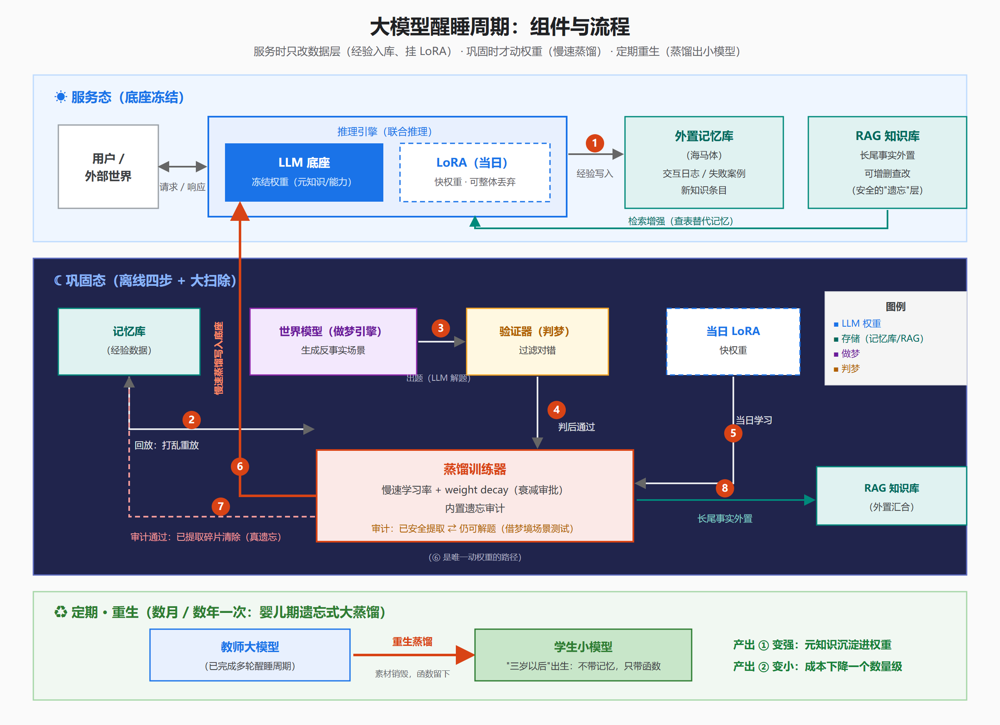
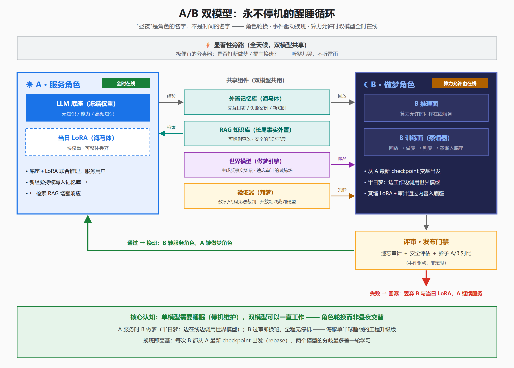

# 大模型需要一场睡眠

> 你在为大模型的"记忆"付钱，却以为在为"智能"付钱。

一篇关于大模型"遗忘"的技术科普与架构提案：为什么大模型学不会遗忘（知识在权重里没有地址）、人脑如何用"双系统 + 睡眠回放 + 做梦 + 定期大扫除"解决这个问题、以及如何把它落成一套 **A/B 双模型醒睡架构**——让模型在睡梦中变强，在遗忘中变小。

## 版本导航

| 版本 | 文件 | 适合场景 |
|------|------|----------|
| 长文版（约 8000 字，含参考文献） | [大模型需要一场睡眠.md](大模型需要一场睡眠.md) | 深度阅读、引用 |
| 缩略版（约 3300 字） | [大模型需要一场睡眠-缩略版.md](大模型需要一场睡眠-缩略版.md) | 公众号 / 知乎 |
| 电梯版（约 800 字） | [大模型需要一场睡眠-800字版.md](大模型需要一场睡眠-800字版.md) | 快速分享 |
| 发布版（单文件 HTML，图已内联） | [大模型需要一场睡眠-缩略版-发布版.html](大模型需要一场睡眠-缩略版-发布版.html) | 浏览器直读 / 导出 PDF |

## 架构图

**醒睡周期：组件与流程** — 服务时只改数据层，巩固时才动权重，定期重生蒸馏。

**A/B 双模型：永不停机的醒睡循环** — 角色轮换而非昼夜交替；换班即变基，两模型分歧最多差一轮学习。

（SVG 源文件：[醒睡周期架构.svg](醒睡周期架构.svg)、[AB双模型醒睡架构.svg](AB双模型醒睡架构.svg)）

## 核心观点

1. **纠缠不是事故，是效率。** 叠加存储让大模型装下海量知识，代价是知识没有地址——unlearning 只是遮蔽，不是删除。
2. **遗忘是默认，记住才需要审批。** 人脑的睡眠回放是一次"求平均"：细节互相抵消，结构沉淀下来。grokking 里的 weight decay 是同一机制。
3. **梦是遗忘的质检车间。** 世界模型生成依赖某条知识的场景，模型仍能解题，才说明知识已内化为能力、原件可删。
4. **单模型需要睡觉，双模型可以一直工作。** A 服务、B 做梦，事件驱动换班，可灰度、可回滚——持续学习变成日常发布。
5. **最大的研究空白是遗忘审计的度量**：如何证明"这条知识已安全蒸成能力"。它一旦存在，遗忘就从外科名词变成运维名词。

> 说明：本文是"愿景综合"——每个零件有独立证据支撑，整机尚未有实验验证。引用请保持同样分寸。
