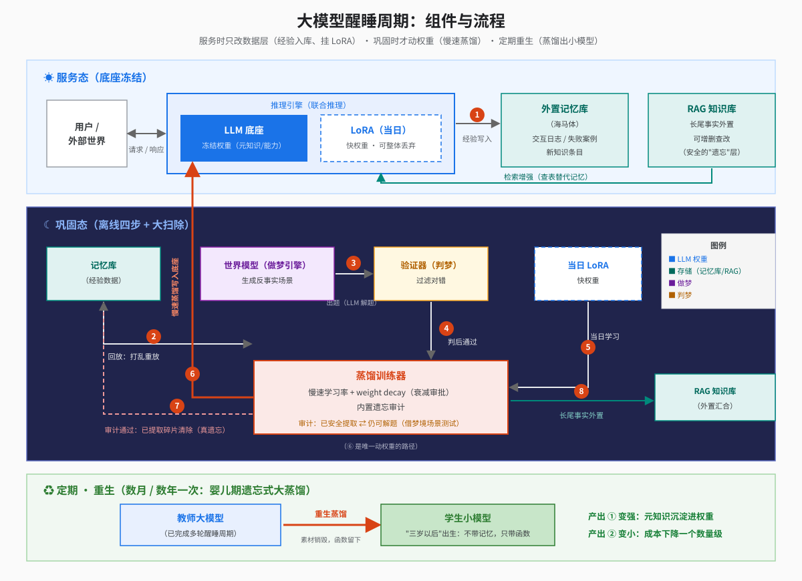
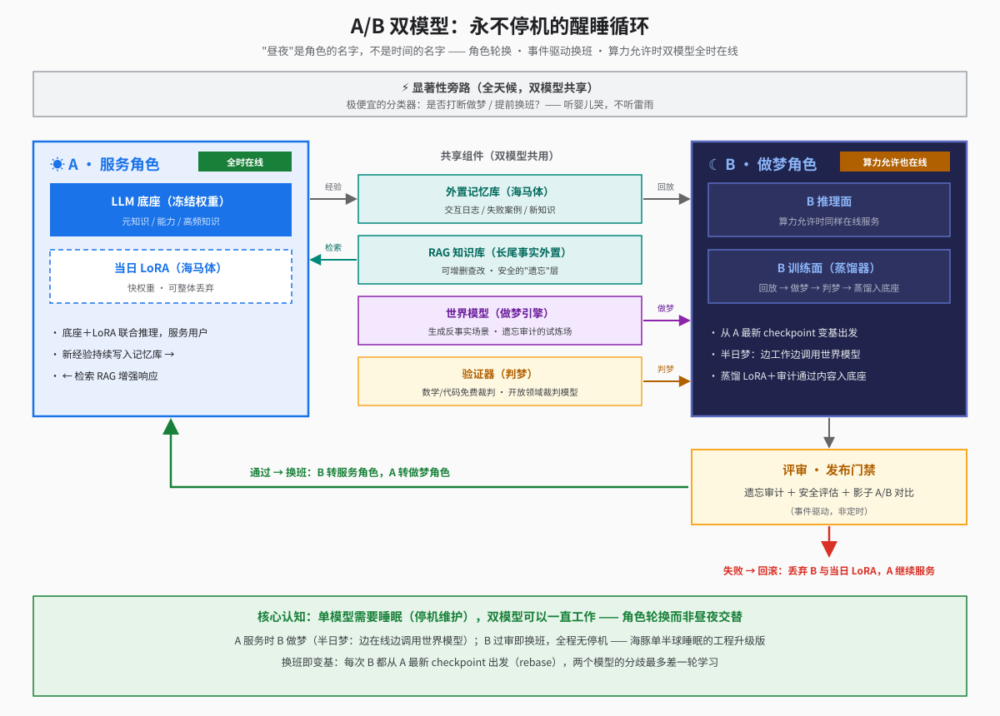

# 大模型需要一场睡眠（缩略版）

> 一句话：大模型贵，贵在为记忆付电费；让它变便宜的前提是安全地遗忘；而遗忘的正确做法，人脑已经跑了上亿年——本文把它翻译成一套可部署的架构。

## 你在为拜占庭史付电费

千亿参数模型的参数里装的是什么？知识容量研究（Allen-Zhu & Li）测算：每个参数约能存 2 bit 的事实。一个读过互联网的模型，参数里塞满了"某小镇的人口、冷门球员的生涯数据、拜占庭帝国某年的税制"这类长尾事实。知识是重尾分布——热点一小撮，碎片一大片。换句话说：**大模型的大部分参数是事实仓库，不是推理引擎。** 旁证是小模型挂上 RAG 就能在知识任务上打平大得多的模型——查表替代了记忆，推理本身并不需要那么多参数。

参数小一个数量级，推理成本、显存、部署门槛就跟着降一个数量级。而今天的成本结构是"每次推理都现场回忆一切"。把事实仓库从权重里剥离出去的办法，名字叫遗忘。

问题是大模型不会遗忘。MoE 模型里那些从不激活的专家，能不能裁？实验说裁掉一部分损失很小，但你不敢——"不激活"是采样数据上测的，罕见输入可能恰好路由到它；裁完平均指标几乎不动，**你无法用评测发现自己丢了什么**。不是剪不动，是不敢剪。

## 为什么不能遗忘：知识没有地址

神经网络用叠加（superposition）存储：一个神经元参与成千上万个特征的编码。这不是缺陷，是训练动力学选出的最优压缩（Anthropic, Toy Models of Superposition）——容量从线性变指数。代价是：**任何一条知识都没有门牌号。**

所以定向遗忘（unlearning）做不干净。ICLR 2025 的研究发现，被"遗忘"的知识用一小撮数据微调就能复活，浅层遗忘下攻击成功率超 70%——信息没离开权重，只是被压住了。纠缠研究（arXiv 2510.25732）进一步证明：一条事实和其余知识缠得越紧越删不掉，这是可测量的结构属性。

于是所有瘦身手段都在同一个权衡里打转：**密度（存得多）、泛化（学得好）、可寻址（删得动），纯参数架构拿了前两个，放弃了第三个。** 量化是无差别降精度，剪枝是钝刀手术，只有 RAG 算"安全的遗忘"——因为它压根没把知识存进权重。但 RAG 只外置得了事实条目，外置不了技能（写代码的手感）和"用得动外挂知识"的元知识。

更深一层：技能本身就是知识蒸出来的。象棋大师面对随机摆放的棋盘，复盘优势完全消失（Chase & Simon, 1973）——棋力的载体就是几十万个内化的棋局模式。素材和成品熔在同一份权重里，事后手术拆不开。

## 人脑早就跑通了

人脑没有在某个单一存储里硬解这个问题，而是造了两个存储，加一套夜间流程：

- **海马体**（快系统）：当天经历单次写入，碎片分开存放，不用就会自然消退；
- **新皮层**（慢系统）：技能和语义的居所，混合叠加存储，和大模型权重一样删不动；
- **睡眠回放**：海马体把记忆打乱、加速重播，驱动皮层把白天重新"经历"一遍，皮层用慢速可塑性学习。打乱重放的数学效果是求平均——各情景独有的细节互相抵消，共有的结构沉淀下来。**遗忘是默认，记住才需要审批。** 深度学习里的 grokking 现象就是这套机制的微缩复刻：weight decay 持续磨掉没有梯度支持的记忆性权重，被反复强化的结构存活下来。

大脑还有两个补充机制。**婴儿期遗忘**：三岁左右删掉几乎全部情景记忆，但语言、走路、对世界的理解全部留下——素材销毁，蒸馏物全留。工程上的模型蒸馏，就是一次人工的"三岁事件"。**做梦**：用内部世界模型生成从未发生过的场景，低成本演练（小鼠走迷宫前，位置细胞会预演路径）。梦是对反事实的巩固，也是 AlphaZero、STaR、RLVR 共同的生物原型。梦的要害在"判梦"：验证器多可靠，梦才有多少价值；而且幻觉有复利，梦要做得短，要勤用真实数据校准。

## 方案：醒睡周期

把零件拼成整机：

- **服务时**：底座冻结，经验写入外置记忆库（海马体），长尾事实进 RAG；
- **巩固时**：回放 → 做梦（世界模型出题）→ 判梦（验证器过滤）→ 慢速蒸馏进底座（带衰减）；同时大扫除——审计"什么已被安全提取"，已提取的碎片删除，长尾外置；
- **定期**：重生蒸馏，蒸出小得多的学生模型，"三岁以后"出生，只带函数不带记忆。

这台机器的每个零件今天都存在：RAG 是外置海马体，replay 是回放，RLVR 是做梦加判梦，weight decay 是衰减，蒸馏是三岁事件。缺的是整机。工业界目前只做最外层——Letta 的 sleep-time agents 整理记忆，Sleep-time Compute 做离线预计算——都只碰数据层，没人动权重。原因很现实：**权重是交付物，动它意味着每天重过一遍安全评估。**

## 落地：A/B 双模型，永不停机

拆这堵墙的办法，软件行业早就有：**在线服务不能改，那就永远不改在线的那个。**

A 服务，B 做梦。A 全时在线，底座冻结，当天的新学习挂在 LoRA 上——LoRA 就是海马体：写入快、可寻址、可整体丢弃。B 从 A 的最新 checkpoint 出发，并行跑回放、做梦、判梦、蒸馏；算力够的话 B 也可以同时在线，边服务边做"半日梦"。B 通过发布门禁（遗忘审计 + 安全评估 + 影子对比）就换班：B 转服务，A 转做梦；评审失败就回滚，丢弃 B 和当日 LoRA。

"昼夜"只是角色的名字，不是时间的名字。**单模型才需要睡觉，双模型可以一直工作**——海豚左右脑轮班，是因为它只有一颗脑；而我们有副本。换班还白送一致性：每次 B 都从 A 变基（rebase），两个模型的分歧最多差一轮学习，漂移还没累积就被抹平。裂脑病人是反例——同步切断后，两个半脑各自演化，还会互相编造理由。

## 结尾

整条链路上最大的空白是**遗忘审计的度量**——怎么证明"这条知识已经安全地蒸成了能力，原件可以丢"。它一旦存在，遗忘就从外科名词变成运维名词，上面每个环节都会被点亮。

我们原以为遗忘是记忆的敌人，大脑的答案相反：**遗忘是提炼记忆的火**——默认一切消亡，让重要的东西在火里自动浮现。大模型不缺记忆，缺的是这场火。给它一场睡眠吧。

（完整论证与参考文献见长文版《大模型需要一场睡眠》）
